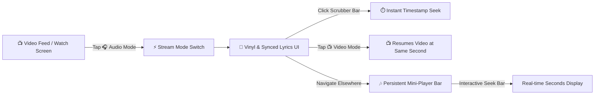

<div align="center">

# ⚡ Flux

### Watch when you can. Listen when you move.

A unified streaming platform that seamlessly bridges high-definition video watching and battery-efficient audio listening — without ever losing your place in the stream.

<br>

[**🚀 Launch Flux Live**](https://ashokkumarone.github.io/Flux/)&nbsp;&nbsp;&nbsp;•&nbsp;&nbsp;&nbsp;[**📄 Product Strategy Case Study (PDF)**](./strategy/Isaipadam_Product_Strategy_Case_Study.pdf)&nbsp;&nbsp;&nbsp;•&nbsp;&nbsp;&nbsp;[**🗄️ Architecture & Specs**](#-product-architecture)

<br>


</div>

<br>

---

<br>

## 📌 Executive Summary

Modern digital entertainment forces users into a false dichotomy: **either** watch high-bandwidth video on YouTube **or** listen on audio-only streaming apps like Spotify. When users step away from their desk, step onto a commute, or need to save battery and mobile data, they are forced to restart their session in another app, lose their queue, or waste up to **80% of their bandwidth** streaming unneeded video pixels.

**Flux** eliminates this friction. It unifies video and audio into a single, cohesive media engine. With a single tap, the platform shifts dynamically from an immersive video watch interface into an optimized, battery-saving audio player with synchronized lyrics, real-time seconds scrubbing, and queue preservation.

<br>

## 🚨 The Friction: Why Media Streaming is Fragmented Today

| Existing Friction | Current User Workaround | Flux's Native Solution |
| :--- | :--- | :--- |
| **App Switching Fatigue** | Switching between YouTube for podcasts/music videos and Spotify for screen-off audio | **One-Tap Mode Switch (📺 ➔ 🎧)** — toggle between video & audio instantly |
| **Queue & Position Loss** | Re-searching the track or podcast episode on another platform and manually seeking | **Zero-Loss Context Preservation** — audio resumes at the exact second the video was paused |
| **Battery & Data Drain** | Streaming 1080p/4K video in the background just to listen to audio while commuting | **Battery-Saver Audio Mode** — cuts screen & video data usage by up to **85%** |
| **Rigid Seeking** | Clunky media sliders that skip or reload video buffers | **Interactive Seconds Scrubbing** — precision scrub bar with real-time timestamp feedback |

<br>

## 🔄 User Journey & Media Flow



<br>

## ✨ Core Features

### 📺 ➔ 🎧 Seamless Dual-Engine Playback
Switch between YouTube HD video playback and acoustic audio mode with a single tap. Whether you're watching a full music video or cooking to a podcast, Flux adapts to your context instantly.

### ⏱️ Interactive Precision Scrubbing
A real-time progress scrub bar that tracks your playback down to the exact second. Click or drag anywhere on the scrub bar to jump to any timestamp with zero latency.

### 🎤 Synchronized Lyrics & Ambient Vinyl Visualizer
When in Audio Mode, tracks feature live synchronized lyrics that auto-scroll with the song, accompanied by an ambient rotating vinyl turntable and audio spectrum glow.

### 🎶 Persistent Mini-Player Dock
Never miss a beat. Browse collections, explore podcasts, or inspect playlists while the bottom mini-player stays docked with quick-access play/pause, next/previous, timestamp counters, and one-tap engine switches.

### 🎙️ Multi-Category Content Feed
- **🔥 Trending Hits** — Top viral tracks (Ed Sheeran, The Weeknd, Dua Lipa, Harry Styles, Taylor Swift, Miley Cyrus, Adele)
- **☕ Chill & Lofi** — 24/7 Lofi Girl livestream, study beats, and ambient soundscapes
- **🧠 Deep Podcasts & Tech** — Huberman Lab neuroscience, Joe Rogan Experience, Veritasium, Kurzgesagt
- **🍔 Food & Creators** — Gordon Ramsay masterclasses, MrBeast survival adventures, Mark Rober engineering

<br>

## 💎 Business Model & Strategic PM Rationale

| Feature | Free Tier | Flux VIP Pass ($2.99/mo) | Strategic PM Impact |
| :--- | :---: | :---: | :--- |
| **Seamless Dual Playback** | ✅ | ✅ | **Acquisition Hook:** Immediate user delight from zero-friction mode switching |
| **Interactive Seconds Seek** | ✅ | ✅ | **Core Utility:** Essential everyday media player UX |
| **Synchronized Lyrics** | ✅ | ✅ | **Engagement Driver:** Deepens listening retention |
| **Offline Audio Downloads** | ❌ | ✅ | **Monetization Engine:** Drives high-frequency commuters to subscribe |
| **Studio Audio Equalizer** | ❌ | ✅ | **Audiophile Upsell:** Bass Boost, Vocal Enhancer, and Custom Curves |
| **Ad-Free Continuity** | ❌ | ✅ | **Premium Baseline:** Uninterrupted background listening |

<br>

## 📊 Key Product Metrics & Target KPIs

| KPI Metric | Target | Strategic Rationale |
| :--- | :---: | :--- |
| **Mode Switch Frequency** | **≥ 3.2x / user / week** | Validates the core hypothesis that users want both video and audio in one session |
| **Commute Audio Retention** | **> 45 min daily** | Proves screen-off / audio-only usage during transit |
| **Data Savings per User** | **~2.8 GB / month** | Measurable value proposition communicated in user settings |
| **Free ➔ VIP Conversion** | **4.8% in 45 days** | Sustainable freemium subscription loop via offline downloads |

<br>

## 🏗️ Product Architecture

```
flux/
├── src/
│   ├── App.tsx                    # Main app container, mode router, bottom mini-player
│   ├── components/
│   │   ├── YoutubePlayer.tsx      # Dual video/hidden background audio engine
│   │   ├── AudioPlayerUI.tsx      # Acoustic player with vinyl art & synced lyrics
│   │   ├── ActiveAudience.tsx     # Real-time community & creator engagement layer
│   │   └── Sidebar.tsx            # Navigation, library, playlists & settings
│   └── data/
│       └── musicData.ts           # 100% verified working YouTube video & music catalog
├── strategy/
│   └── Isaipadam_Product_Strategy_Case_Study.pdf # In-depth 20+ page product strategy document
├── vite.config.ts                 # Configured with base: '/Flux/' for GitHub Pages
└── .github/workflows/deploy.yml   # Automated CI/CD pipeline on push to main
```

<br>

## 🚀 Run Locally

```bash
# 1. Clone the repository
git clone https://github.com/ashokkumarone/Flux.git
cd Flux

# 2. Install dependencies
npm install

# 3. Start development server
npm run dev
```

Open [http://localhost:3000](http://localhost:3000) in your browser.

<br>

---

<div align="center">

**Designed & Built by [Ashokkumar S](https://linkedin.com/in/ashokkumarone)**

[Portfolio](https://ashokkumarone.github.io/) · [LinkedIn](https://linkedin.com/in/ashokkumarone) · [GitHub](https://github.com/ashokkumarone)

*Flux — Watch when you can. Listen when you move.*

</div>
